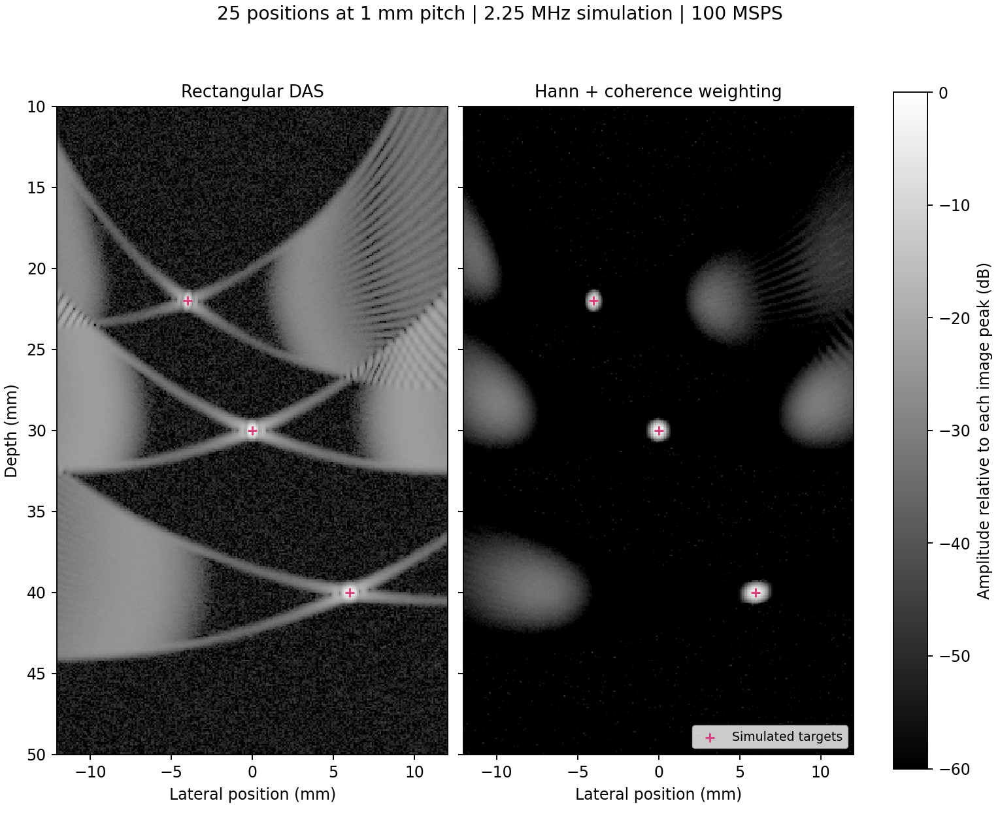

# Ultrasound DAS review and Eclypse implementation

Prepared for Chinmay Govilkar • Updated 11 October 2026

The selected platform is now Eclypse Z7 + Zmod Scope 1410-105, configured at
100 MSPS with calibrated signed 16-bit RF. A reusable FPGA line buffer captures
one receiver channel, ARM stores 25 records in DDR, and Python reconstructs the
image. The current vendor controller, clock and packing contracts replace the
previous ZedBoard/FMC150 assumptions. The acoustic DAS model is unchanged.

Repository: chinmay-govilkar/Ultrasound_fpga. Original audited base commit:
60ca7e9d2e5efb4c3410f4c75788b38b5ea6b251. All six original Verilog files and the
README were read. There was no Python implementation, Vivado project, CORDIC
configuration, SelectIO configuration, XDC, measured RF dataset or testbench in
that snapshot. The revised Python is runnable; revised RTL is functionally
simulated post-PHY logic. A verified board bitstream remains a separate milestone.

## 1 What the proposed algorithm can build

The proposed gather-and-sum operation is a valid starting point for a mechanically
scanned, monostatic synthetic aperture: one element transmits and receives at each
position, recording one RF trace. The 25 channels are 25 sequential acquisition
records, not 25 simultaneous ADC channels. Each pixel receives a contribution
from each recorded position at the correct two-way echo time.

Assumptions are a stationary target and medium during the full scan, accurately
known transmit/receive positions, coherent and repeatable transmit pulses,
calibrated timing, homogeneous sound speed, and an adequate phase-centre model
for the chosen element. The implementation supports separate TX/RX positions
for bistatic acquisitions, but it does not assume plane-wave transmission.

Mechanically moving one element does not provide ultrafast imaging of moving
anatomy. Frame time includes all moves, settling, firings and transfers. For
example, 25 positions taking 10 ms each already need about 250 ms per scan,
before other costs; that hypothetical scan gives at most about 4 frames/s.
Ultrafast plane-wave imaging needs a different transmit/receive architecture,
usually many simultaneous receivers. Jensen et al. [1] provides synthetic-aperture
background; the present 25 same-element Tx/Rx records are a restricted acquisition.

## 2 Correct timing and intensity equations

For pixel p=(x,z) and monostatic position r_k=(x_k,z_k), define R_k=norm(p-r_k).

```text
ideal_echo_time_k = 2 * R_k / c
fractional_index_k = Fs * (ideal_echo_time_k + system_delay_k - t0_k)
```

For distinct transmit and receive centres, replace 2*R_k by
norm(p-tx_k)+norm(p-rx_k). Coordinate units are metres; Fs is samples per second;
c is metres per second; all timing fields are seconds. Indices are zero-based.

`t0_k` is the time label of stored sample zero relative to the transmit reference.
Positive `system_delay_k` makes the measured echo later than the acoustic flight
time. Include ADC/PHY/analogue latency in one calibrated convention; do not add
it again if the sample-origin value already accounts for it. For a known wire
target, estimate delay from measured arrival time minus predicted acoustic time,
then confirm at another depth. Use the actual sound speed of the medium; 1540 m/s
is an example setting, not a universal value for water, plastics or a layered path.

Multiplying flight time by Fs gives a fractional coordinate, not an exact integer
sample. Default linear interpolation uses j=floor(s), alpha=s-j:

```text
value_k = (1-alpha) * RF[k,j] + alpha * RF[k,j+1]
coherent_pixel = sum_k(weight_k * value_k)
```

Nearest-sample mode uses floor(s+0.5). Negative or beyond-record sample times are
masked to zero. They never wrap around the memory, and no repeated edge sample
is inserted. At the last exact sample, interpolation uses that sample safely.

Keep positive and negative RF values through the sum. Taking absolute value
before addition destroys coherent cancellation. The returned signed_rf is useful
for RTL comparison; a signed oscillatory sum is not itself a displayed intensity.
The software computes the analytic signal of each RF trace, interpolates and
sums those complex values, then takes magnitude for the envelope. B-mode uses
20*log10(envelope/reference), clipped to the selected dynamic range. Squared
envelope would represent power; its logarithm would instead use 10*log10.
Taking absolute value once per real output pixel is not an analytic envelope.

## 3 Numerical checks for the selected platform

Example: 25 positions x_k=(k-12)*1 mm, c=1540 m/s, Fs=100 MSPS, no timing offsets.
For pixel (0,30 mm), the centre trace index is 3896.103896, nearest index 3896.
The outer trace at x=-12 mm has index 4196.232317, nearest index 4196.

| Position magnitude (mm) | Fractional index | Nearest sample |
| --- | --- | --- |
| 0 | 3896.103896 | 3896 |
| 1 | 3898.267797 | 3898 |
| 2 | 3904.752306 | 3905 |
| 3 | 3915.535956 | 3916 |
| 4 | 3930.583364 | 3931 |
| 5 | 3949.845799 | 3950 |
| 6 | 3973.261959 | 3973 |
| 7 | 4000.758909 | 4001 |
| 8 | 4032.253168 | 4032 |
| 9 | 4067.651887 | 4068 |
| 10 | 4106.854104 | 4107 |
| 11 | 4149.752028 | 4150 |
| 12 | 4196.232317 | 4196 |

Positive and negative positions have the same delay for this centred pixel;
general pixels have different delays. The longest path in x=-12..12 mm,
z=10..50 mm takes 72.028180 us. At 100 MSPS its index is 7202.817986, requiring
at least 7204 samples for the grid, before timing uncertainty and pulse-tail
margin. The 80 us example contains 8000 samples and ends at 79.99 us. At verified
105 MSPS the corresponding minimum is 7564 samples and the 80 us record is 8400.
The helper required_samples uses the actual stored Fs and calibrated geometry.
Older 250 MSPS acquisitions remain valid with their original Fs; changing only
the file's rate would change inferred depths and is not resampling.

## 4 Flaws found in the original repository on 6 October

| Location | Defect and effect | Resolution |
| --- | --- | --- |
| das_single_channel.v | sqrt(X^2+Z^2) was used directly as a memory address. Length has no sample-time unit. Outward/return travel, c, Fs and latency were absent. | Software computes calibrated two-leg delays and exports integer/fractional descriptors. |
| das_beamformer_top.v | Address slice used [(i+1)*DEPTH_BITS-1 +: i*DEPTH_BITS]; channel zero has zero width and later slices run outside the bus. | Eliminate this invalid packing; explicit scalar line and adjacent-address request fields. |
| das_beamformer_top.v | Only the lower 10 address bits were retained, silently wrapping deeper echoes. | Explicit record bounds in Python/LUT; production data in DDR; no address truncation accepted as range handling. |
| das_beamformer_top.v | RF slices and accumulator were unsigned, making negative echoes large positive numbers. | Signed samples, interpolation products, accumulator and RF output. |
| das_memory_matrix.v and top | 1024 samples at 250 MSPS cover only 4.096 us, about 3.15 mm two-way axial range from time zero. | Whole echo-window capture; matrix retained only as a small-record adapter. |
| das_beamformer_top.v | CORDIC valid was consumed without the synchronous RAM-read latency, so data belonged to earlier addresses. Only one of 25 valids was checked. | One outstanding request, response handshake, interpolation-valid stage, held output. |
| das_channel_math.v | Signed 16-bit micrometre coordinates cannot represent +50 mm. Subtraction and squared sums could overflow. | 18-bit diagnostic coordinates, widened differences/squares/sum, valid/reset pipeline. |
| Position generation | Original pitch was 0.5 mm and origin 0..12 mm, unlike a centred aperture. | Measured configurable positions; example uses -12..12 mm at 1 mm. |
| fmc150_axi_capture.v | aclk was unused while stream outputs were clocked by div_clk: an unhandled clock-domain boundary. | Explicit sample-clock AXIS boundary; external vendor clock converter where needed. |
| fmc150_axi_capture.v | No TREADY, TLAST, echo-window trigger/count or finite capture; zero padding lost sign extension. | Whole-line buffering, sign extension, finite packet, stable AXIS handshake and status. |
| ultrasound_engine_top.v | TVALID/TLAST were dropped during stalls and source pixels were not backpressured. | Acquisition top and optional DAS core hold output until handshake. |
| Envelope/readiness | abs() was described as envelope; missing generated IP/constraints were described as active hardware. | Analytic envelope in software; missing physical integration clearly identified. |
| Repository hygiene | .gitignore.txt is not Git's ignore filename; no executable reference or verification suite. | .gitignore, standalone Python, RF packer, Python/HDL tests and synthesis scripts. |

## 5 Memory RF bandwidth and arithmetic

At 100 MSPS one physical 14-bit ADC input produces 1.4 Gbit/s of converter data.
The calibrated int16 channel is 200 MB/s; both packed channels are 400 MB/s.
The whole-line buffer accepts the echo window at full cadence, then drains it
without letting DMA backpressure stop the converter. Do not record throughout
mechanical moves when only a finite echo window is needed.

| Capture strategy | Samples across 25 positions | Selected-channel int16 storage |
| --- | --- | --- |
| 80 us at 100 MSPS | 200000 | 400000 bytes |
| 80 us at verified 105 MSPS | 210000 | 420000 bytes |
| Default after anti-aliased /4 RF decimation | 50000 | 100000 bytes |
| 2 s per position at 100 MSPS | 5000000000 | 10 GB |

Eclypse has 1 GiB DDR3L [6]; XC7Z020 has 140 RAMB36 blocks [4]. The default
25-position int16 dataset has 3.2 Mbit and fits the nominal 5.16 Mbit BRAM
capacity, but allocating 25 independent 8192x16 banks would consume roughly
100 RAMB36 blocks. At 105 MSPS, rounding each 8400-word record to 16384 words
would need about 200 blocks, exceeding capacity. Other packed memory layouts
may differ. The initial design therefore retains one reusable 16384x16 line
buffer and DDR for all records; budget actual mapping before adding full RF BRAM.

The buffer supports 80 us at both 100 and 105 MSPS. Its simple drain takes three
sample-clock cycles per word, approximately 240 us per 80 us record without
stalls. This is appropriate when mechanical settling dominates. It is a finite
recording design, not continuous capture during draining.

The physical ADC is 14-bit but the controller's calibrated RF is signed 16-bit.
Twenty-five full-scale values sum to -819200 or +819175; 21 signed integer bits
cover this range. Q12 interpolation retains additional fractional and guard
bits, rounds once after accumulation and produces signed 32-bit RF. Do not
truncate calibration results to 14 bits or take magnitudes before summation.

100 MSPS strongly oversamples a 2.25 MHz carrier. Optional resample_poly
anti-aliased /4 decimation yields 25 MSPS while preserving the timing origin.
The >60 MSPS requirement is met by the ADC acquisition; an optional processed
RF rate can be lower if the received bandwidth and image error permit it.
Validate passband and timing before implementing a hardware decimator.

## 6 Physical image quality limitations

Wavelength is about 0.684 mm at 2.25 MHz and c=1540 m/s. For this monostatic
point model, narrowband phase is 4*pi*R/lambda. Its spatial derivative has
magnitude 4*pi*sin(theta)/lambda, giving a local Nyquist spacing condition
pitch <= lambda/(4*sin(theta_max)). At 30 degrees this is about 0.342 mm;
at 60 degrees it is about 0.198 mm. Use the highest relevant RF frequency for
a broadband bound. This is a model-derived local sampling guide, not a blanket
guarantee for a finite piston or arbitrary geometry.

Consequently, 0.5 or 1 mm steps risk grating lobes when a wide angular aperture
is used. With 25 positions, decreasing pitch also decreases aperture and can
worsen lateral resolution. Preserve the 24 mm span with more positions if angular
coverage requires finer sampling, or restrict angular coverage based on measured
directivity and accept the corresponding resolution change. Apodisation and
coherence weighting reduce sidelobes/clutter but cannot recover unsampled space.

If the earlier 13 mm diameter, 2.25 MHz disk is still the intended element,
the approximate circular-piston near-field length D^2/(4*lambda) is about 62 mm
in the example medium [9]. Much of the proposed 10..50 mm image then lies in a
nonuniform field. The code's point-centre approximation must be checked with
wire targets and the actual focus/beam response. max_angle_deg is an optional
gate, not a full finite-aperture field correction. A focused element may require
a different virtual-source model. Sound-speed errors, refraction, motion,
out-of-plane scattering and transmit phase changes also defocus the image.

The demonstration deliberately uses 25 positions at 1 mm pitch and point sources.
Targets are (0,30 mm), (-4,22 mm) and (6,40 mm); the brightest target reconstructs
at (0,30 mm). The accompanying comparison shows the strong sparse-aperture
artifacts in plain DAS and their reduction with Hann plus coherence weighting.
Remaining bright lobes are not asserted to be real targets. No measured phantom,
speckle, finite-piston field or clinical image quality is claimed.



## 7 Hardware and software allocation

| Function | Initial location | Reason and later option |
| --- | --- | --- |
| Zmod clock/SPI/IDDR/FIFO and gain calibration | Digilent controller plus ARM configuration | Preserve vendor physical interface; load factory processed coefficients and relay states. |
| Trigger/record count/line capture | FPGA | Deterministic echo-window timing; full-line buffer absorbs DMA stalls. |
| Stage move/settle and scan identity | ARM/controller | Mechanical control and acquisition metadata. |
| DMA, cache-safe buffers, DDR storage | FPGA DMA plus ARM driver | Store 25 logical records without 25 full BRAM banks. |
| Calibrated delays and geometry | Python on PC initially | Easy to inspect; includes real positions, c and timing offsets. |
| Filtering, analytic signal, DAS, envelope/log/image | Python | Complete numerical reference before optimising hardware. |
| Optional RF gather/interpolate/sum | Reviewed sequential RTL core | Software-generated delays, DDR or deliberately reduced BRAM data; baseline signed DAS only. |

The optional core has no DDR AXI master or descriptor-DMA adapter. Those board
integration blocks are explicitly still required. It is a tested compute core,
not a replacement for the entire acquisition system. It processes positions
sequentially, not one complete pixel per clock. The 241x401 grid needs 2416025
contributions; even four 100 MHz cycles per valid contribution already cost
roughly 97 ms before additional memory latency and output stalls. Actual throughput must
be measured. Parallelism, caching, tiling and on-chip decimation can be considered
after calibrated images and the dominant bottleneck are established.

For analytic-envelope parity with the Python reference, hardware would need
both analytic I and Q contributions (or a validated equivalent signal pipeline).
The existing optional core returns the real RF sum only. Two appropriately
scaled I/Q passes are a possible extension; that preprocessing/packing is not
provided. Applying abs to real RF does not supply the missing quadrature signal.

## 8 Exact file inventory and interface changes

| File | Delivered role |
| --- | --- |
| beamform_das.py | Complete standalone DAS API and CLI; monostatic/bistatic geometry, calibration, interpolation, analytic envelope, coverage, optional taper/aperture/CF/filter/decimation, synthetic data and LUT export. |
| pack_rf.py | Raw binary DMA to calibrated NPZ, explicit ADC encoding, measured positions/timing and rail count. |
| adc_line_capture.v | Replaces fmc150_axi_capture.v; generic finite 16384x16 capture, source error status and stable AXIS packet. |
| zmod_scope_adapter.v | New current-controller adapter; physical CH1/CH2 selected at arm, permanent upstream TREADY. |
| eclypse_z7.py | New 100 MSPS profile, 105 MSPS ceiling and calibrated packed-channel decoder. |
| hardware/eclypse_scope_config.tcl | New controller parameter configuration for Scope 1410-105 at 100 MSPS in an existing BD. |
| ultrasound_engine_top.v | Current Zmod controller boundary, source readiness/error gating and selected-channel acquisition. |
| das_beamformer_top.v | Rewritten software-delay, external-memory signed core with pixel/frame progress and protocol_error. |
| das_single_channel.v | Rewritten signed Q12 interpolation pipeline; missing CORDIC dependency removed. |
| das_memory_matrix.v | Rewritten small-record matrix with two synchronous reads, held responses and line-range error. |
| das_channel_math.v | Rewritten optional wide squared-distance diagnostic, reset and valid pipeline; not connected to active DAS. |
| tests and hardware/synth_ooc.tcl | Numerical and RTL regression suites, independent integer vectors, synthesis/resource checks and reproducible Vivado synthesis entry point. |
| README, hardware/integration.md, docs | Updated architecture, integration contracts, audit and validation evidence. |

The original six Verilog interfaces were replaced during the first review. This
revision changes the acquisition top to the current Zmod controller boundary,
adds a physical-channel adapter and uses signed 16-bit defaults in the optional
compute path. Rebuild the BD by named ports. Stage 1 uses the top, adapter and
line capture; the other four modules are optional acceleration/diagnostic logic.
Vendor IP, physical constraints, control CDC and DMA remain external project blocks.

The LUT is pixel-major and includes addr0, addr1, fractional coefficient and
validity. A full 96641x25 table already occupies tens of MB in its exported
native array representation. Keep it in host/DDR memory or generate it by tiles;
it does not fit in Z7020 BRAM. Inspect hardware/integration.md for descriptor
TLAST convention, memory response protocol and cache/DMA requirements.

## 9 How to run and use the code

```bash
python -m pip install -r requirements.txt
python beamform_das.py simulate --output-dir results/demo
python beamform_das.py reconstruct results/demo/acquisition.npz --output-dir results/tapered --apodization hann --coherence-weight
python pack_rf.py frame.bin --samples 8000 --fs-mhz 100 --receiver-channel 1 --output acquisition.npz
python beamform_das.py reconstruct acquisition.npz --output-dir results/real
python beamform_das.py export-lut acquisition.npz --output-dir results/lut
```

For measured data, pack_rf accepts either one line-major frame file or 25 files
listed in acquisition order. The default signed16 format is little-endian calibrated int16 from the new top.
The scope32 format extracts CH1 upper or CH2 lower int16 from current controller
words. raw16 explicitly decodes uncalibrated, right-aligned ADC codes. Legacy
ZmodADC1410_Controller words are not scope32. Channel, gain and coupling flags
record actual settings; software flags do not configure hardware. Override example pitch using measured CSV positions in metres;
override sound speed and time calibration. NPZ stores those fields with RF and Fs.

Reconstruction outputs signed_rf, analytic_das, envelope, relative bmode_db,
valid_count, weight_sum, coherence_factor and image axes in an NPZ, plus metadata
JSON and a PNG. Unsupported pixels are zero signal and the display floor.
Inspect coverage before interpreting image darkness. Defaults use rectangular,
unnormalised coherent sums matching the stated algorithm; Hann, normalisation,
dynamic aperture and coherence weighting are explicit options. No automatic gain
correction, calibrated acoustic power, attenuation compensation or contrast
metric is silently implied. Reuse preprocessing and options consistently when
comparing acquisitions. Use --help for complete controls.

## 10 Validation completed and limits

Twenty-three Python tests passed: the original eighteen numerical regressions
plus current-controller packing/channel selection, 100 and 105 MSPS record
bounds, complete binary import, calibrated int16 full-scale NPZ/DAS and metadata
validation. Retained 250 MSPS tests check the generic algorithm and old-file
compatibility; the selected hardware importer rejects acquisition rates over
105 MSPS. Coherent cancellation and no-wrap timing remain verified.

Four Icarus suites passed: generic capture, the new current-Zmod top, wide
geometry and 36 pixels of 25-position signed Q12 DAS. Tests include both physical
channels with distinct int16 extremes, channel-selection changes after arm,
permanent upstream readiness during DMA stalls, source initialization/error
gating, missing words, overflow/error handling, memory and output stalls,
malformed descriptors and frame TLAST. The default 16384-sample top elaborated.

Yosys 0.33 7-series mapping and structural checks passed. The acquisition top
uses 8 RAMB36E1 blocks for its line buffer; the optional int16 DAS compute core
uses 2 DSP48E1 and no RF storage. These estimates exclude vendor controller,
DMA, PS, CDC and routing. Capture mapping emitted 40 primitive-port resizing
warnings; they are not a Vivado timing result.

The 100 MSPS, 25x8000 synthetic acquisition completed simulate, reconstruct,
Hann/CF reconstruction and Q12 LUT export. The brightest target remained at
(0,30 mm). The figure was regenerated at the selected rate. Numeric and resource
results are recorded in docs/validation.md. Vivado, board-level DRC/CDC/post-route
timing and on-board analogue acquisition were not run here. Vendor PHY and
configuration are outside the RTL test boundary.

## 11 Selected board and required integration

Eclypse Z7 + Zmod Scope 1410-105 is the selected platform, replacing the previous
ZedBoard/FMC150 recommendation. The carrier is XC7Z020-1CLG484C with 1 GiB DDR3L;
the Scope has two AD9648 14-bit inputs and a 105 MSPS maximum [6,7,11]. No further
board purchase is needed for the stated >60 MSPS single-receiver proof of concept.

Use the current Digilent ZmodScopeController [11] with factory gain/offset
calibration. It outputs calibrated signed 16-bit CH1 in bits 31..16 and CH2 in
15..0. Its TREADY must remain high; do not wire it to a stalling DMA. The new
adapter selects one physical receiver input per record, and the whole-line buffer
provides the finite DMA packet. Twenty-five mechanical rows are still sequential
records from the same physical input, not twenty-five simultaneous receivers.

100 MSPS is the explicit default configuration and meets the requested rate.
For this profile SysClk100, ADC_SamplingClk and ADC_InClk are each 100 MHz with
kADC_ClkDiv=1 and kSamplingPeriod=10000 ps. Apply vendor phase/routing constraints,
initialize and verify the physical rate. The checked low-level reference [12]
used 40 MSPS and divider 4; importing it unchanged is insufficient. An explicitly
verified rate up to 105 MSPS can be used with consistent clocks, constraints and
file metadata. The product maximum alone proves neither the installed clock
nor routed timing. The old ZmodADC1410_Controller/software format is different.

Follow hardware/integration.md for synchronized source status and PS commands,
relay/calibration wiring, DMA width/clock conversion and byte counts. Configure
DMA length width at least 16 for the 32768-byte buffer maximum. For the receiver,
choose the actual protected input signal's gain and coupling; the nominal ranges
are +/-1 V high gain and +/-25 V low gain [7]. Scope inputs do not replace a pulser,
T/R protection, receive amplifier or anti-alias filter.

## 12 Next physical milestones

First obtain a single clean trigger-aligned A-scan with ADC test pattern/sine-wave
verification. Then calibrate a known stationary wire at two depths, verify stage
coordinates and repeatability, and acquire all 25 records without clipping or
lost samples. Reconstruct with plain DAS and inspect coverage and target location
before enabling weighting. Compare scan pitches and the measured beam footprint.
Only then evaluate FPGA acceleration, measured image contrast/resolution and
moving-target limitations. Finalise the pin/clock constraints and run Vivado DRC,
CDC and post-route timing before describing the acquisition as board-ready.

## Sources

Original sources checked 6 October 2026; Eclypse and current controller sources
rechecked 11 October 2026. Historical FMC150 sources concern the original audit. Geometry, numeric budgets, audit findings
and validation results are derived in this work; product facts below come from
the respective manufacturers or authors.


1. Jensen et al., Synthetic Aperture Ultrasound Imaging, Ultrasonics 44 (2006), e5-e15: https://orbit.dtu.dk/en/publications/synthetic-aperture-ultrasound-imaging/

2. Abaco FMC150 specifications/BSP: https://www.abaco.com/Products-and-Services/Digital-Signal-Processing/FPGA-Mezzanine-Cards/FMC150

3. Digilent/Avnet ZedBoard Hardware User Guide v2.2: https://files.digilent.com/resources/programmable-logic/zedboard/ZedBoard_HW_UG_v2_2.pdf

4. AMD Zynq-7000 Overview DS190: https://docs.amd.com/v/u/en-US/ds190-Zynq-7000-Overview

5. TI ADS62P49 datasheet: https://www.ti.com/lit/ds/symlink/ads62p49.pdf

6. Digilent Eclypse Z7: https://digilent.com/shop/eclypse-z7/

7. Digilent Zmod Scope 1410, including variant rates/support: https://digilent.com/shop/zmod-scope-1410-2-channel-14-bit-oscilloscope-module/

8. ADI AD-FMCDAQ2 hardware and ZC706 Linux support: https://www.analog.com/en/resources/evaluation-hardware-and-software/evaluation-boards-kits/eval-ad-fmcdaq2-ebz.html and https://wiki.analog.com/resources/eval/user-guides/ad-fmcdaq2-ebz/software/linux

9. Evident circular-transducer beam/near-field formula: https://ims.evidentscientific.com/en/learn/ndt-tutorials/flaw-detection/beam-characteristics

10. AMD AXI DMA PG021 user parameters: https://docs.amd.com/r/en-US/pg021_axi_dma/User-Parameters


11. Digilent current ZmodScopeController guide, calibrated data path and module map, pinned to f4613fff005b098065fd5d619a2b88e55720a423: https://github.com/Digilent/vivado-library/tree/f4613fff005b098065fd5d619a2b88e55720a423/ip/Zmods/ZmodScopeController

12. Digilent Eclypse low-level filter hardware, pinned to 5ea221a3fceb430d7b3005d49ce373cb10bea154: https://github.com/Digilent/Eclypse-Z7-HW/tree/5ea221a3fceb430d7b3005d49ce373cb10bea154
